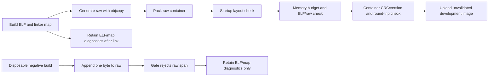

# uv-k5-rust-firmware

Standalone Rust migration target for the UV-K5(8). It has a minimal Cortex-M0
reset/vector path and linker layout, but remains an unqualified bootstrap, not
a flashable firmware image. It makes no assumptions about the radio's boot ROM,
bootloader handoff, clock state, or physical hardware revision.

## Requirements and checks

The repository pins Rust 1.99.1 and the `thumbv6m-none-eabi` target in
`rust-toolchain.toml`. With rustup installed, run these commands from the
repository root:

```sh
cargo fmt --all -- --check
cargo clippy --all-targets -- -D warnings
cargo test --all-targets
cargo rustc --locked --target thumbv6m-none-eabi --release \
  --bin uv-k5-rust-firmware -- \
  -C link-arg=-Map=target/thumbv6m-none-eabi/release/uv-k5-rust-firmware.map
python3 scripts/check_startup_layout.py \
  --elf target/thumbv6m-none-eabi/release/uv-k5-rust-firmware \
  --map target/thumbv6m-none-eabi/release/uv-k5-rust-firmware.map
python3 -m unittest discover -s tests -v
```

The crate has no external dependencies or allocator requirement. The startup
layout checker and memory-budget checker use only the Python standard library;
the optional real-image memory-gate fixtures also use GNU ARM binutils.

## Continuous integration

The `Copilot Setup Steps` workflow installs the Rust tools from
`rust-toolchain.toml`, GNU ARM binutils, and Graphify with its Copilot skill for
Actions-backed Copilot cloud agent sessions. This setup applies only to those
sessions; it does not change local development or the normal quality checks.

The `Rust quality` workflow runs on pushes and pull requests. Its stable required
checks are `Rust quality / Host checks` (formatting, Clippy, and host tests) and
`Rust quality / Cortex-M0 release build`. Each job installs the toolchain,
components, and target from `rust-toolchain.toml`; Cargo commands use the
tracked lockfile. Host checks exercise startup-layout and ELF/raw-payload
memory-budget fixtures with positive and negative cases. The target job checks
the built ELF and linker map, records their SHA-256 hashes in the workflow
summary, and always attaches those diagnostics after a successful link. The
separate development-image artifact is uploaded only after the startup-layout,
memory-budget, and packed-container checks pass. The raw and packed files are
unvalidated development outputs: the bootstrap is not hardware-validated and
must not be treated as flashable or release-ready. The isolated negative job
adds one byte to a disposable raw payload, requires the memory gate to reject it,
and keeps its ELF/map diagnostics without uploading raw or packed output.



For local offline inspection of a candidate raw payload, create it from the
linked ELF and run the memory gate:

```sh
arm-none-eabi-objcopy -O binary firmware.elf firmware.bin
python3 scripts/check_memory_budget.py \
  --elf firmware.elf \
  --raw firmware.bin \
  --stack-reservation 0x800 \
  --packed firmware.packed.bin
```

Omit `--packed` when no packed container is produced. This checks an exact
ELF/raw pair; it does not establish that an image is accepted by a bootloader
or safe for a device. The required 2 KiB stack reservation is excluded from
static RAM ranges and reserved at the top of RAM.
The checker rejects missing or malformed reservations and ordinary data
overlapping the stack. The raw payload limit is 61,440 bytes. A packed container's
length is reported separately and is not subject to that limit. The checker
prints flash-load, raw-payload, RAM, stack, and per-`PT_LOAD` usage and
remaining-capacity figures. The gate's implementation, accounting rules, and
fixture coverage are documented in [the target contract](docs/target-contract.md).

To confirm CI failure propagation without committing broken code, run the
workflow manually and select `host-test` or `target-build` for `failure_probe`.
That disposable run injects a failing test or target compile error and is
expected to fail. Locally, make the equivalent temporary injection in a
disposable worktree:

```sh
cat >> src/lib.rs <<'RS'
#[cfg(test)]
#[test]
fn intentional_failure_propagates() {
    assert!(false, "intentional CI failure probe");
}
RS
cargo test --locked --all-targets
```

For the target probe, append
`compile_error!("intentional Cortex-M0 build failure probe");` to
`src/bin/firmware.rs`, then run
`cargo build --locked --target thumbv6m-none-eabi --release`. Both commands
must return nonzero; do not commit either injection.

There is no C reference or parity job in the default workflow. The documented
`UV_K5_C_REFERENCE` environment variable is not consumed by current checks.
Any future mixed/parity lane must be separately opt-in, require an immutable
reference revision, and reject a missing, floating, or modified C checkout;
it must not fall back to an upstream branch. No image may be published until
the mandatory size gate from issue
[m0hdy/uv-k5-rust-firmware#26](https://github.com/m0hdy/uv-k5-rust-firmware/issues/26)
has passed for that exact ELF and raw payload in every flashable job.
Upload its linker map and budget report on an always-run path after the gate so
a gate failure still retains the diagnostics.

## Reference firmware

The default commands above do not require or inspect a C firmware checkout or
any reference environment variable. For future parity tooling that explicitly
uses a reference checkout, select it with:

```sh
export UV_K5_C_REFERENCE=/path/to/reference-firmware
```

No current build or test command consumes this variable.

## File ownership

This repository owns its Cargo and toolchain configuration, the host-testable
Rust library in `src/lib.rs`, and the target-only entry in
`src/bin/firmware.rs`. The target integration's single owner maintains reset
and vectors in `src/bin/startup.S`, the memory layout in `linker/firmware.ld`,
and the offline ELF/map and image checks in `scripts/`. There is no second
startup path. The pinned C firmware remains the reference owner of its source
and is unchanged. Current CI publishes no raw or packed image.
