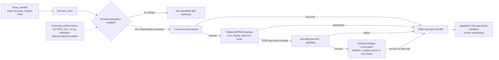
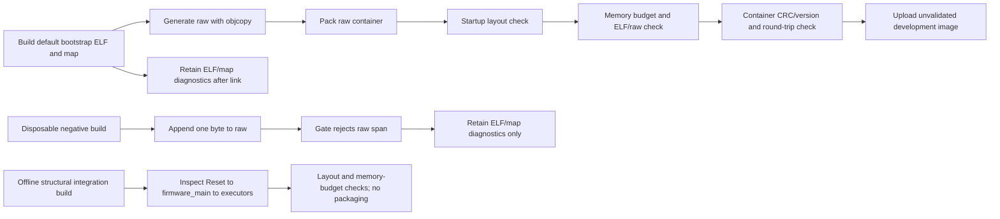

# uv-k5-rust-firmware

M0HDY's standalone Rust port for the UV-K5(8), based on the
[egzumer C firmware](docs/reference-baseline.md). It has a minimal Cortex-M0
reset/vector path and linker layout, but remains an unqualified bootstrap, not
a flashable firmware image. It makes no assumptions about the radio's boot ROM,
bootloader handoff, clock state, or physical hardware revision.

## Licensing

Original project work is licensed under the ISC License; see [`LICENSE`](LICENSE).
Apache-2.0 exceptions, third-party notices, and the full provenance inventory
are recorded in [`NOTICE`](NOTICE),
[`LICENSE-APACHE-2.0`](LICENSE-APACHE-2.0), and
[`docs/licensing.md`](docs/licensing.md).

## Selected firmware entry

The default `firmware_main` is still a non-installable bootstrap and performs
no peripheral startup. The opt-in `firmware-integration` feature selects the
real startup composition from that same entry, then parks after welcome because
the application loop and radio/keypad behavior are not implemented. The
[entry contract](docs/firmware-entry-integration.md) specifies its required
external policy inputs and the limits of offline evidence.



The selected integration reuses the
[board startup sequence](docs/board-startup-adapters.md), reads core/display
settings and the welcome mode through the explicitly welcome-extended
composition (the legacy settings API remains two-block), samples the battery
through the existing bounded executor, hands PA10/PA11 back after
EEPROM STOP, and uses the already-initialized display for the version row.
`None` and `FullScreen` modes issue no welcome-row transfer. ADC interrupt
delivery is disabled before SARADC setup and remains masked; the startup does
not rely on an ADC ISR. Successful welcome is not application completion.

The [component guide](docs/components.md) describes these boundaries and links
to subsystem behavior and focused checks. The [welcome boundary](docs/startup-version-display.md)
also remains independently callable; the opt-in firmware path specifically
uses its already-initialized-display continuation.

## Requirements and checks

The repository pins Rust 1.99.1 and the `thumbv6m-none-eabi` target in
`rust-toolchain.toml`. With rustup installed, run these commands from the
repository root:

```sh
cargo fmt --all -- --check
cargo clippy --all-targets -- -D warnings
cargo test --all-targets
cargo rustc --locked --target thumbv6m-none-eabi --release \
  --bin uv-k5-rust-firmware -- \
  -C link-arg=-Map=target/thumbv6m-none-eabi/release/uv-k5-rust-firmware.map
python3 scripts/check_startup_layout.py \
  --elf target/thumbv6m-none-eabi/release/uv-k5-rust-firmware \
  --map target/thumbv6m-none-eabi/release/uv-k5-rust-firmware.map
python3 -m unittest discover -s tests -v
```

The opt-in entry additionally requires the caller to set every `UVK5_*`
variable documented in [the entry contract](docs/firmware-entry-integration.md)
and build with `--features firmware-integration`. The build has no production
policy defaults; a structural CI build uses explicitly labelled offline
fixtures and is neither executed nor packaged.

The crate has no external dependencies or allocator requirement. The startup
layout checker and memory-budget checker use only the Python standard library;
the optional real-image memory-gate fixtures also use GNU ARM binutils.

## Continuous integration

The `Copilot Setup Steps` workflow installs the Rust tools from
`rust-toolchain.toml`, GNU ARM binutils, and Graphify with its Copilot skill for
Actions-backed Copilot cloud agent sessions. This setup applies only to those
sessions; it does not change local development or the normal quality checks.

The `Rust quality` workflow runs on pushes and pull requests. Its stable required
checks are `Rust quality / Host checks` (formatting, Clippy, and host tests) and
`Rust quality / Cortex-M0 release build`. Each job installs the toolchain,
components, and target from `rust-toolchain.toml`; Cargo commands use the
tracked lockfile. Host checks exercise startup-layout and ELF/raw-payload
memory-budget fixtures with positive and negative cases. The Cortex-M0 job
checks the default bootstrap ELF and linker map, then separately builds the
opt-in integration with labelled offline-only structural inputs and inspects
the selected entry call path, layout, and memory budget without packaging it.
It records the bootstrap ELF and linker map hashes in the workflow summary and
attaches those diagnostics after a successful link. The
separate development-image artifact carries the packed version label `*M0HDY dev`
and is uploaded only after the startup-layout,
memory-budget, and packed-container checks pass. The raw and packed files are
unvalidated development outputs: the bootstrap is not hardware-validated and
must not be treated as flashable or release-ready. The isolated negative job
adds one byte to a disposable raw payload, requires the memory gate to reject it,
and keeps its ELF/map diagnostics without uploading raw or packed output.
The [recovery runbook](docs/recovery-runbook.md) defines the mandatory
no-flash-until-recoverable preflight and rollback evidence.



For local offline inspection of a candidate raw payload, create it from the
linked ELF and run the memory gate:

```sh
arm-none-eabi-objcopy -O binary firmware.elf firmware.bin
python3 scripts/check_memory_budget.py \
  --elf firmware.elf \
  --raw firmware.bin \
  --stack-reservation 0x800 \
  --packed firmware.packed.bin
```

Omit `--packed` when no packed container is produced. This checks an exact
ELF/raw pair; it does not establish that an image is accepted by a bootloader
or safe for a device. The required 2 KiB stack reservation is excluded from
static RAM ranges and reserved at the top of RAM.
The checker rejects missing or malformed reservations and ordinary data
overlapping the stack. The raw payload limit is 61,440 bytes. A packed container's
length is reported separately and is not subject to that limit. The checker
prints flash-load, raw-payload, RAM, stack, and per-`PT_LOAD` usage and
remaining-capacity figures. The gate's implementation, accounting rules, and
fixture coverage are documented in [the target contract](docs/target-contract.md).

To confirm CI failure propagation without committing broken code, run the
workflow manually and select `host-test` or `target-build` for `failure_probe`.
That disposable run injects a failing test or target compile error and is
expected to fail. Locally, make the equivalent temporary injection in a
disposable worktree:

```sh
cat >> src/lib.rs <<'RS'
#[cfg(test)]
#[test]
fn intentional_failure_propagates() {
    assert!(false, "intentional CI failure probe");
}
RS
cargo test --locked --all-targets
```

For the target probe, append
`compile_error!("intentional Cortex-M0 build failure probe");` to
`src/bin/firmware.rs`, then run
`cargo build --locked --target thumbv6m-none-eabi --release`. Both commands
must return nonzero; do not commit either injection.

The default workflow runs host tests that exercise the Rust vector evaluator.
It does not run the pinned C comparator or require a C checkout or
`UV_K5_C_REFERENCE`. The standalone reports below can be run locally.
No image may be published until the
mandatory size gate from issue
[m0hdy/uv-k5-rust-firmware#26](https://github.com/m0hdy/uv-k5-rust-firmware/issues/26)
has passed for that exact ELF and raw payload in every flashable job.
Upload its linker map and budget report on an always-run path after the gate so
a gate failure still retains the diagnostics.

## Reference firmware

The Rust evaluator executes all 39 checked-in vectors against the host Rust
library and does not use a C checkout:

```sh
python3 tools/reference-vectors/compare_rust.py
```

The optional C comparator recaptures those cases from the pinned public C
revision and compares inputs and outputs with the checked-in fixture. Set
`UV_K5_C_REFERENCE` to a clean checkout at
`7607f0a4bd6203d1f06b70556fc1ce0d7399d6b3`:

```sh
export UV_K5_C_REFERENCE=/path/to/reference-firmware
python3 tools/reference-vectors/compare.py
```

Both commands produce standalone local reports. The C comparator
rejects a checkout at another commit or with tracked or untracked changes; it
never substitutes a moving upstream branch. It reports per-case input or
result mismatches, including the canonical and captured results.

Regenerating the fixture is a separate, explicit operation. It uses the same
pinned, clean checkout and overwrites `tests/reference-vectors/golden.json`:

```sh
UV_K5_C_REFERENCE=/path/to/clean/reference-firmware \
  python3 tools/reference-vectors/capture.py --write
```

Review the fixture diff and its provenance before accepting regenerated data.

## File ownership

This repository owns its Cargo and toolchain configuration, the host-testable
Rust library in `src/lib.rs`, and the target-only entry in
`src/bin/firmware.rs`. The target integration's single owner maintains reset
and vectors in `src/bin/startup.S`, the memory layout in `linker/firmware.ld`,
and the offline ELF/map and image checks in `scripts/`. There is no second
startup path. The pinned C firmware remains the reference owner of its source
and is unchanged. Current CI publishes no raw or packed image.

## Contributing and community

See [contributing guidance](CONTRIBUTING.md) for issue-driven work, host and
target checks, and required firmware evidence. Read the
[Code of Conduct](CODE_OF_CONDUCT.md) and [security reporting guidance](SECURITY.md)
before participating or reporting a concern. Use the
[bug report](.github/ISSUE_TEMPLATE/bug_report.yml) or
[feature request](.github/ISSUE_TEMPLATE/feature_request.yml) form in the
[issue form picker](https://github.com/m0hdy/uv-k5-rust-firmware/issues/new/choose)
for public project requests; do not report vulnerabilities or include
sensitive device data in public issues.
