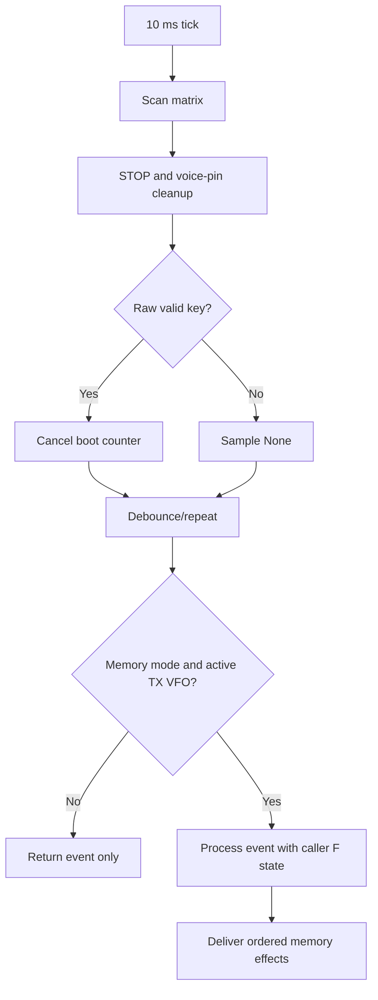

# Offline keypad memory-channel flow

[`src/app_keypad_memory_flow.rs`](../src/app_keypad_memory_flow.rs) composes
the real matrix scan, 10 ms debounce/repeat state, and
[`app_numeric_input_flow`](../src/app-numeric-input-flow.md). The caller
retains `KeypadMemoryFlow`, supplies a `MatrixIo` implementation and invokes
`poll` once per 10 ms tick. It also supplies the current memory-mode, F-key,
selected-VFO, and active-TX-VFO state; the flow owns none of those application
states.

Every scan completes its STOP and voice-pin cleanup before downstream effects.
A raw valid matrix key cancels the caller's boot counter on every poll,
including repeated held-key polls. Debounced events from that same scan follow
the cancellation. Only memory mode with an active TX VFO delivers events to
numeric entry; the caller's F state is passed to the existing memory-entry
logic. Press beeps, non-held releases, validity checks, and successful VFO,
save, and reload effects retain their existing order. Held digit events do not
append or select. PTT is absent from the matrix and cannot be generated by
this flow.



This is an allocation-free offline composition, not scheduler, UI, storage,
GPIO MMIO, transmitter, or RF wiring. The host mocks exercise the literal
matrix scan and normal-return cleanup; they do not validate hardware behavior.

## Focused validation

Run from the repository root:

```sh
cargo test --locked --test app_keypad_memory_flow --test app_numeric_input_flow
cargo clippy --locked --test app_keypad_memory_flow --test app_numeric_input_flow -- -D warnings
rustfmt --edition 2024 --check src/app_keypad_memory_flow.rs \
  src/app_numeric_input_flow.rs tests/app_keypad_memory_flow.rs
rustc --edition=2024 --crate-type=lib --target thumbv6m-none-eabi \
  -D warnings src/app_keypad_memory_flow.rs -o /tmp/app_keypad_memory_flow.rlib
```

The integration test drives the actual matrix mock through three debounced
digit releases for `007`, checks the literal valid-channel VFO/save/reload
effects, and covers invalid input, held digits, eligibility gates, boot
cancellation, and cleanup ordering.
