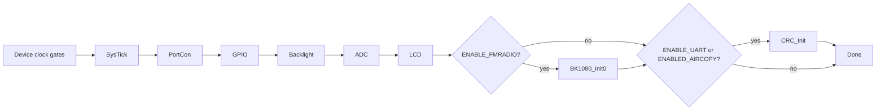

# Offline default board bring-up sequence

## Pinned provenance

This independently authored, call-level model follows public
[`egzumer/uv-k5-firmware-custom@7607f0a4bd6203d1f06b70556fc1ce0d7399d6b3`](https://github.com/egzumer/uv-k5-firmware-custom/tree/7607f0a4bd6203d1f06b70556fc1ce0d7399d6b3):

- [`main.c:61–77`](https://github.com/egzumer/uv-k5-firmware-custom/blob/7607f0a4bd6203d1f06b70556fc1ce0d7399d6b3/main.c#L61-L77):
  device clock gating, `SYSTICK_Init()`, then `BOARD_Init()`.
- [`board.c:490–505`](https://github.com/egzumer/uv-k5-firmware-custom/blob/7607f0a4bd6203d1f06b70556fc1ce0d7399d6b3/board.c#L490-L505):
  the calls inside `BOARD_Init()`, including their preprocessor guards.
- [`board.c:47–59`](https://github.com/egzumer/uv-k5-firmware-custom/blob/7607f0a4bd6203d1f06b70556fc1ce0d7399d6b3/board.c#L47-L59):
  the separate `ENABLE_OVERLAY`-guarded `BOARD_FLASH_Init()` path containing
  `SYSTEM_ConfigureClocks()`. Neither belongs to this default sequence.
- The pinned [`Makefile`](https://github.com/egzumer/uv-k5-firmware-custom/blob/7607f0a4bd6203d1f06b70556fc1ce0d7399d6b3/Makefile)
  enables `ENABLE_FMRADIO` and `ENABLE_UART` by default.

## Trace contract

`src/board_sequence.rs` exposes typed `Call` events, a `Backend` consumer, and
`run(Defines, &mut backend)`. Dispatch is synchronous and allocation-free.
`BOARD_Init()` is flattened rather than emitted as an additional event.

| Order | Event | Pinned C operation / condition |
| --- | --- | --- |
| 1 | `DeviceClockGates` | `SYSCON_DEV_CLK_GATE` assignment |
| 2 | `SystickInit` | `SYSTICK_Init()` |
| 3 | `PortconInit` | `BOARD_PORTCON_Init()` |
| 4 | `GpioInit` | `BOARD_GPIO_Init()` |
| 5 | `BacklightInitHardware` | `BACKLIGHT_InitHardware()` |
| 6 | `AdcInit` | `BOARD_ADC_Init()` |
| 7 | `St7565Init` | `ST7565_Init()` |
| 8, optional | `Bk1080Init0` | `BK1080_Init0()` under `#ifdef ENABLE_FMRADIO` |
| Last, optional | `CrcInit` | `CRC_Init()` under `#if defined(ENABLE_UART) || defined(ENABLED_AIRCOPY)` |

The first event represents the entire clock-gate assignment, not separate
per-device calls. Its unconditional C terms are
`SYSCON_DEV_CLK_GATE_GPIOA_BITS_ENABLE`,
`SYSCON_DEV_CLK_GATE_GPIOB_BITS_ENABLE`,
`SYSCON_DEV_CLK_GATE_GPIOC_BITS_ENABLE`,
`SYSCON_DEV_CLK_GATE_UART1_BITS_ENABLE`,
`SYSCON_DEV_CLK_GATE_SPI0_BITS_ENABLE`,
`SYSCON_DEV_CLK_GATE_SARADC_BITS_ENABLE`,
`SYSCON_DEV_CLK_GATE_CRC_BITS_ENABLE`,
`SYSCON_DEV_CLK_GATE_AES_BITS_ENABLE`, and
`SYSCON_DEV_CLK_GATE_PWM_PLUS0_BITS_ENABLE`.
Their values and register effects are not modeled; gating CRC is distinct
from the optional `CRC_Init()` call.

`Defines` fields describe macro **presence**, not a C macro's numeric value:
`enable_fmradio` maps to `ENABLE_FMRADIO`, `enable_uart` to `ENABLE_UART`, and
`enabled_aircopy` to the exact spelling `ENABLED_AIRCOPY`. Defining a macro
as `0` still satisfies these C guards. `ENABLE_AIRCOPY` alone does not satisfy
the CRC guard. No corrected spelling or implied aircopy behavior is substituted.
With no macros present the trace has seven events; the pinned Makefile defaults
produce nine, with FM followed by CRC. Both CRC guards together still emit CRC
only once.



## Focused validation

From any working directory, with the repository's pinned Rust toolchain:

```sh
cd /home/runner/work/uv-k5-rust-firmware/uv-k5-rust-firmware
cargo test --locked --test board_sequence
cargo clippy --locked --test board_sequence -- -D warnings
rustfmt --check --edition 2024 \
  /home/runner/work/uv-k5-rust-firmware/uv-k5-rust-firmware/src/board_sequence.rs \
  /home/runner/work/uv-k5-rust-firmware/uv-k5-rust-firmware/tests/board_sequence.rs
rustc --edition=2024 --crate-type=lib --target thumbv6m-none-eabi \
  -D warnings \
  /home/runner/work/uv-k5-rust-firmware/uv-k5-rust-firmware/src/board_sequence.rs \
  -o /tmp/board_sequence.rlib
```

The fixed-capacity fake backend checks the exact base trace, all eight
combinations of the three macro-presence flags, and the pinned Makefile-default
trace. Exact trace equality excludes overlay clock/flash calls and extra calls.
Standalone Cortex-M0 compilation checks that the module needs neither `std`
nor an allocator; it is not linked into startup or the firmware entry point.

## Scope and acceptance

This is dispatch-order evidence only. Events do not implement operations,
call existing hardware plans, or establish hardware side effects, timing,
clock readiness, pin configuration, or safe board wiring. There is no MMIO,
startup change, reset/flash trim, transmit operation, or device test.
The shared inventory, ABI, and mixed-fallback paths are unchanged.

[Parent task #38](https://github.com/m0hdy/uv-k5-rust-firmware/issues/38)
and physical acceptance remain open. Passing host traces and a standalone
`no_std` compile do not establish board bring-up or device acceptance.
