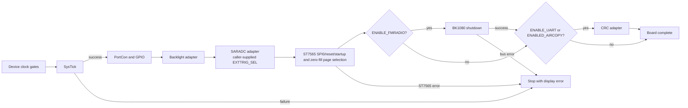

# Board startup adapter witness

`src/board_startup_adapters.rs` dispatches the existing sequencer into the
clock-gate, SysTick, PortCon, GPIO, backlight, and SARADC target adapters.
`ENABLE_SWD` is forwarded to PortCon and `ENABLE_FMRADIO` to GPIO. Backlight
initialization reuses
`backlight_startup_executor::initialize_backlight_hardware`; `Call::AdcInit`
reuses `adc_startup_adapter::apply_to_hardware` after backlight. The next
`Call::St7565Init` reuses
`st7565_startup_executor::target_spi0::startup_mmio`. `BootConfig` supplies
the ADC's `exttrig_sel` and a nonzero ST7565 FIFO poll budget; the caller
supplies independent millisecond `DelayMs` and microsecond `Delay1us`
implementations. The pinned
`BOARD_ADC_Init()` leaves `EXTTRIG_SEL` uninitialised, so no production value
is selected here. `Call::Bk1080Init0` uses the existing
`bk1080_startup_adapter::shutdown_mmio` when FM is enabled. It means
`BK1080_Init(0, 0)`, not receive initialization. After this optional shutdown,
`Call::CrcInit`
uses `crc_startup_adapter::apply_to_hardware` exactly once if `ENABLE_UART` or
`ENABLED_AIRCOPY` is present. Otherwise no CRC register is accessed. SysTick,
ST7565 or BK1080 failure stops all later board calls; display and FM failures
retain their typed causes.



The host tests check the composed call order, exact ADC trigger and display
poll-budget forwarding, caller delay use, backlight register sequence, fresh
read-modify-write behavior, preservation of unrelated clock and PORTB bits,
and error short-circuiting. The boot integration test runs the existing
`target_spi0::startup_with_io`, BK1080 shutdown and CRC word executors and
checks their traces.
Target execution requires the DP32G030 PWM_PLUS0 and PORTB register mappings,
the PWM_PLUS0 clock gate enabled by the earlier clock-gate stage, B6 reserved
for the backlight and selected for PWMP0_CH0 by the backlight mux update, and
exclusive access to PWM_PLUS0 CLKSRC, PERIOD, GEN, CFG and PORTB SEL0 for the
complete sequence.

The FM shutdown sends START, `80 04 02 41`, STOP, then freshly reads GPIOB
DATA and writes it with PB15 set. A failed START has no STOP; a failed write
or NACK gets one best-effort cleanup STOP, and a failed final STOP is not
retried. PB15 is asserted after cleanup even on error, and the original typed
bus error is returned. Disabled FM performs no FM bus transaction or PB15
access; an earlier board failure prevents the shutdown.

For enabled FM, GPIOA, GPIOB and PORTCON must be mapped and clocked, PA10/11
must be muxed and initialized for GPIO I2C, and PB15 must be a GPIO output.
Own the shared bus exclusively and suspend keypad use through the transaction,
cleanup and PA10/11 handoff back to keypad mode. Serialize that entire interval
against all writers and interrupt handlers touching GPIOA DATA/DIR, PORTA
input-enable/open-drain or GPIOB DATA, including unrelated-bit writers, because
the operations are whole-register read-modify-writes. Supply an accurate,
non-panicking `Delay1us` that does not access shared registers; no timing
policy is inferred.

The earlier device-clock assignment already enables CRC bit 27; no new
clock policy is introduced. For an enabled CRC stage, the caller must ensure
the CRC clock remains enabled and the aligned 32-bit registers at `0x40003000`
and `0x40003004` are mapped and writable with appropriate privilege. Own
both whole CR and IV registers and serialize the complete call against all
other CRC users, including interrupt handlers. The adapter assigns `0x100`
and then `0` to these registers; it does not calculate CRCs or implement UART
or AirCopy.

The ST7565 target stage calls the existing `target_spi0::startup_mmio`; it
does not create a second startup plan or delay provider. Before entering it,
the caller must have the SPI0 and GPIOB register mappings and clocks enabled,
operational FIFO/status registers, and an idle SPI0 bus. B7/B8/B10 must
already be muxed for display SPI0, PB9 configured as the A0 GPIO output, and
PB11 configured as the reset GPIO output and owned by the display. PB11 reset
ownership conflicts with live SWD use of that pin; enabling SWD does not
resolve the conflict. The caller must pass a `DelayMs` implementation that
provides the requested milliseconds and a nonzero FIFO poll budget. No delay
calibration, pin mux, or production poll-budget default is supplied here.

Keep exclusive display ownership throughout the operation, including every
delay and the page handoff. Serialize against every writer, including
interrupts, to SPI0 CR/WDR/IE/IF/FIFOST, GPIOB DATA, and the SYSCON device
clock gate. These whole-register/interrupt serialization requirements cover
the complete multi-register startup, not only individual volatile accesses.
`FillScreen(0)` preserves the pinned behavior: it selects pages 0 through 7
but writes no pixel bytes. Board wiring does not call the initialize-and-show
welcome APIs. The already-initialized-display continuation is the distinct
`eeprom_welcome_startup::welcome_on_initialized_display_with_io` entry (or
its explicit-version counterpart); it acquires the welcome mode and continues
without reinitializing the controller.

The existing interrupt obligations remain: install a valid SysTick handler
before enabling SysTick, and if preserved SARADC IE bits can enable NVIC IRQ 4,
install a valid handler at vector slot 20 and prevent that IRQ from racing
initialization. Serialize the entire SARADC operation against every writer to
its touched SYSCON/SARADC registers and IRQ line. Neither the board adapter
nor the link-only witness supplies operational handlers. The default
`firmware_main` path remains unchanged; this board-stage wiring does not
invoke it or complete application startup.

The link-only witness enables synthetic FM and CRC features and uses delay
stand-ins only to retain and inspect the concrete target call path. It does
not model elapsed time, provide production timing, or establish a timing policy;
the witness is never executed or published. The synthetic feature configuration
is not production policy.

The SARADC adapter may enable NVIC IRQ 4 when preserved SARADC IE bits are
nonzero. Before running startup with interrupt delivery possible, install a
valid handler in the active vector at slot 20 and prevent that IRQ from racing
initialization as needed. Serialize the entire SARADC operation against every
writer to the touched SYSCON and SARADC registers, including updates to
unrelated shared clock fields, and against changes to the SARADC NVIC line.
The link-only witness passes a synthetic trigger only to exercise argument
forwarding; it is not production policy. The witness does not provide an
operational SARADC IRQ handler or prove that a device vector slot is safe. Host
and link-only checks do not establish any of these hardware preconditions.

CI separately links `startup-witness/` for Cortex-M0 with a dedicated
vector table and a returning SysTick handler. Its linker places code at
`0x10000000` and RAM at `0x20010000`, outside the DP32G030 memory map, and
enforces 16 KiB code/load and 4 KiB RAM limits. The existing inspection has
not yet been updated for the FM-enabled witness: it rejects the changed
`run_hardware` frame and does not prove the new shutdown chain. Its previous
checks cover vector
targets, the linked sequencer-to-adapter call path, reachable ADC, ST7565, and
CRC stages, the concrete display `startup_mmio` to `startup_with_io` call chain,
reachable backlight register accesses and their order, retained adapter
symbols, and section budgets. The ADC path is checked through its existing
word adapter to `apply_with_io`; the
register/NVIC transaction behavior remains covered by the focused ADC adapter
tests. The SysTick vector must match the exact linked handler symbol, whose
first instruction must be `bx lr`.

The backend-dispatch check is intentionally pinned to the emitted Cortex-M0
shape and the nine sequencer variants. The ST7565 case checks its arguments,
returned error encoding and success and error continuations. The ADC case
forwards the trigger field, the backlight path preserves the pinned register
sequence, and the CRC path reaches its two ordered word writes. Reset and
`witness_main` retain their intentional terminal loops and are not treated as
returning wrappers.
Unexpected instructions, conditional branches, or changed guard inputs,
destinations, and continuations are rejected. This is linked structural
evidence for the emitted paths; it is not a general-purpose Thumb control-flow
analyzer and does not establish that arbitrary callees or MMIO operations
complete.

Run focused host tests, target checks, and link-only witness inspection from
the repository root:

```sh
cargo test --locked --test board_startup_adapters
cargo test --locked --test adc_startup_adapter
cargo test --locked --test boot_coordinator
cargo clippy --locked --test board_startup_adapters --test boot_coordinator \
  --test board_startup_composition --test backlight_startup_executor \
  --test adc_startup_adapter -- -D warnings
RUSTFLAGS='-D warnings' cargo check --locked --lib --target thumbv6m-none-eabi
python3 -m unittest tests.test_startup_witness
RUSTFLAGS='-D warnings -C link-arg=-Tlinker/startup-witness.ld -C link-arg=-Map=../target/startup-witness/startup-adapter-witness.map' \
  cargo build --locked \
  --manifest-path startup-witness/Cargo.toml \
  --target thumbv6m-none-eabi \
  --release \
  --target-dir target/startup-witness
python3 scripts/check_startup_witness.py \
  --elf target/startup-witness/thumbv6m-none-eabi/release/startup-adapter-witness
```

The witness ELF and map are local link-inspection outputs under the ignored
`target/` directory. CI does not convert or upload them, and the witness must
never be executed on hardware. The existing firmware build, startup, and
published-image steps are unchanged.

## Default bootstrap parity

The default bootstrap was rebuilt at the PR base and at the startup-witness
revision below using Rust/Cargo 1.99.1, GNU ARM binutils 2.42, Python 3.12.3,
and identical pack metadata (`UV-K5`, version `dev`). Both source revisions
produce byte-identical ELF, raw, and packed files:

| Source | Commit |
| --- | --- |
| PR base | `dd57ac6a8f605808b8b54049afffef86ffe0f33d` |
| Startup witness | `d9683ba8ada802c74510d46e4d1f1e78d06c8d76` |

| Output | Bytes | SHA-256 at both commits |
| --- | ---: | --- |
| Cortex-M0 ELF | 81,092 | `8544956cb9e90ee8069f5f2d087ecec039d30ea8ab975dd723b98aba0d5f5657` |
| Raw objcopy payload | 300 | `febbcabeb65d724e573494cf64ef6dd6e0bd96a5e2ab3aaf9423030b87c25dbd` |
| Packed container (`UV-K5`, `dev`) | 318 | `0b9f64b6e28a243046cd42efd6ac22774fc4d13b7f8df71c66e1b3f2b86eb8df` |

Reproduce the comparison from a checkout containing both commits:

```sh
set -eu
comparison=$(mktemp -d)
trap 'rm -rf "$comparison"' EXIT
base=dd57ac6a8f605808b8b54049afffef86ffe0f33d
witness=d9683ba8ada802c74510d46e4d1f1e78d06c8d76

for revision in "$base" "$witness"; do
  dir="$comparison/$revision"
  mkdir -p "$dir"
  git archive "$revision" | tar -x -C "$dir"
  (
    cd "$dir"
    cargo rustc --locked --target thumbv6m-none-eabi --release \
      --bin uv-k5-rust-firmware --target-dir target -- -D warnings
    out=target/thumbv6m-none-eabi/release
    arm-none-eabi-objcopy -O binary \
      "$out/uv-k5-rust-firmware" "$out/uv-k5-rust-firmware.raw"
    python3 scripts/firmware_container.py pack \
      "$out/uv-k5-rust-firmware.raw" "$out/uv-k5-rust-firmware.packed" \
      --author UV-K5 --version dev
  )
done

for file in uv-k5-rust-firmware uv-k5-rust-firmware.raw uv-k5-rust-firmware.packed; do
  cmp "$comparison/$base/target/thumbv6m-none-eabi/release/$file" \
    "$comparison/$witness/target/thumbv6m-none-eabi/release/$file"
  sha256sum \
    "$comparison/$base/target/thumbv6m-none-eabi/release/$file" \
    "$comparison/$witness/target/thumbv6m-none-eabi/release/$file"
done
```

These are parity measurements of the unvalidated bootstrap, not witness
artifacts or flashable firmware.
