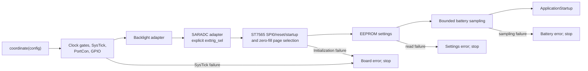

# Startup boot coordinator

`src/boot_coordinator.rs` runs the existing board startup adapter sequence,
reads the core and display settings through the fallible EEPROM composition,
then collects and calibrates four bounded battery samples. The board sequence
executes the backlight and SARADC adapters, followed by the concrete ST7565
SPI0/reset startup executor. `BootConfig::exttrig_sel` supplies the SARADC
trigger selection and `st7565_fifo_poll_limit` supplies the nonzero per-byte
display poll budget. The caller passes the `DelayMs` implementation to
`coordinate`; no production delay or polling default is inferred. The
coordinator returns one `ApplicationStartup` value only after all three
stages succeed. A board, EEPROM, or battery failure returns a typed
`BootError`; display failures preserve their `LineError` cause, and settings
or battery data are not handed to the application on an error.

The supported subsequence is compared with pinned
[`main.c:61–109`](https://github.com/egzumer/uv-k5-firmware-custom/blob/7607f0a4bd6203d1f06b70556fc1ce0d7399d6b3/main.c#L61-L109):

| Coordinator stage | Relation to pinned C |
| --- | --- |
| Board adapter sequence | Models clock gates, SysTick, `BOARD_Init` calls and optional startup calls from `Main`. Target adapters execute backlight initialization through the fresh-read executor, SARADC initialization through the existing ADC executor, and ST7565 initialization through `target_spi0::startup_mmio`. `EXTTRIG_SEL`, the `DelayMs` provider, and nonzero FIFO poll budget are explicit inputs. BK1080 and CRC remain typed placeholders. |
| Fallible settings read | Reads the existing core and display blocks corresponding to the beginning of `SETTINGS_InitEEPROM`; it does not implement the rest of that C routine, build-option writes, or calibration loading. |
| Bounded battery sampling | Runs four bounded channel-4/channel-9 acquisitions with caller-supplied calibration, corresponding to the four-sample loop after radio setup in this region. |



This is not full `Main` parity or a complete boot path. The coordinator omits
the initial `BOARD_ADC_GetBatteryInfo` before EEPROM settings; UART setup and
version output; authentic-device checks; DTMF initialization; the C BK4819
initialization; EEPROM build-option and calibration operations; radio/VFO
configuration; `BATTERY_GetReadings(false)` and its display/charging policy;
AM-fix setup; boot-mode and key-release handling; welcome UI; and application
loop setup. No battery calibration value, battery poll budget, display delay,
or ST7565 FIFO poll budget is supplied by default. The board path does not
call initialize-and-show welcome, the separate already-initialized-display
welcome continuation, or `firmware_main`; those callable welcome entries and
application entry wiring remain outside this coordinator.

Production use requires concrete implementations of all three I/O boundaries.
The board boundary must execute every required hardware stage, including the
remaining typed placeholders, with clocks, pin muxes, register mappings,
exclusive startup ownership, and valid interrupt vectors/handlers established.
Backlight execution specifically requires the PWM_PLUS0 clock gate enabled
before the stage, DP32G030 PWM_PLUS0/PORTB mappings, B6 reserved and selected
for PWMP0_CH0 by the backlight mux update, and exclusive access to the touched
registers.

The board ADC operation forwards `BootConfig::exttrig_sel` unchanged. The
pinned `BOARD_ADC_Init()` does not initialize `EXTTRIG_SEL`; neither this
coordinator nor the link-only witness establishes a production setting. The ADC
adapter may enable NVIC IRQ 4 when preserved SARADC IE bits are nonzero. If IRQ
delivery is possible, the active vector slot 20 must name a valid handler, and
delivery must not race startup. Serialize the entire SARADC call against all
writers to the touched SYSCON/SARADC registers (including unrelated fields in
shared registers) and the SARADC NVIC line. The witness is link-only and does
not implement an operational ADC interrupt handler. Host tests and linked
inspection do not establish these hardware preconditions or validate physical
backlight/ADC behavior. For ST7565 mappings and clocks, idle SPI0, preconfigured
display mux and A0/reset pins, PB11 reset versus live SWD conflict,
whole-register/interrupt serialization across delays, and the page-selection
only `FillScreen(0)` behavior, see [board startup adapters](board-startup-adapters.md).
The EEPROM boundary must be backed by the device's initialized I2C transport.
The battery boundary requires the SARADC clock, channels 4 and 9 configured
for software-triggered sampling, exclusive SARADC access, a bounded poll
budget, and a calibration obtained from the appropriate settings/calibration
path. Those prerequisites and hardware behaviors are not validated by the host
test. The default firmware entry point and firmware artifact remain unchanged;
this coordinator is a library integration point, not a claim of hardware-ready
firmware.

The host integration test exercises the actual board sequencer adapter,
concrete ST7565 register/delay executor trace, fallible EEPROM settings
composer, and battery sampler with shared mock event recording. It checks
stage ordering, exact trigger and poll-budget forwarding, one display
initialization, and short-circuit failures before settings or battery effects.
Focused validation:

```sh
cargo test --locked --test boot_coordinator
RUSTFLAGS="-D warnings" cargo check --locked --lib --target thumbv6m-none-eabi
```
