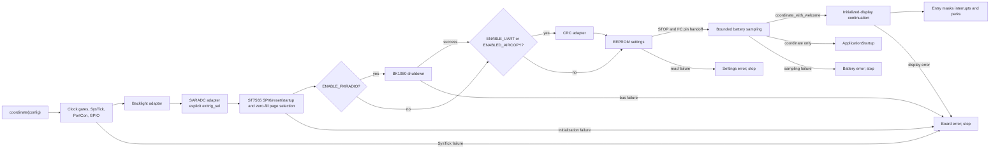

# Startup boot coordinator

`src/boot_coordinator.rs` runs the existing board startup adapter sequence,
reads the core, display, and welcome settings through the fallible EEPROM composition,
then collects and calibrates four bounded battery samples. The board sequence
executes the backlight and SARADC adapters, followed by the concrete ST7565
SPI0/reset startup executor, conditional BK1080 shutdown and optional CRC
initialization.
`BootConfig::exttrig_sel` supplies the SARADC trigger selection and
`st7565_fifo_poll_limit` supplies the nonzero per-byte display poll budget.
The caller passes independent `DelayMs` and `Delay1us` implementations to
`coordinate`; no production delay or polling default is inferred. The
coordinator returns one `ApplicationStartup` value only after all three
stages succeed. A board, EEPROM, or battery failure returns a typed
`BootError`; display and shutdown failures preserve their typed causes, and settings
or battery data are not handed to the application on an error.

The supported subsequence is compared with pinned
[`main.c:61–109`](https://github.com/egzumer/uv-k5-firmware-custom/blob/7607f0a4bd6203d1f06b70556fc1ce0d7399d6b3/main.c#L61-L109):

| Coordinator stage | Relation to pinned C |
| --- | --- |
| Board adapter sequence | Models clock gates, SysTick, `BOARD_Init` calls and optional startup calls from `Main`. Target adapters execute backlight, SARADC, ST7565, conditional BK1080 shutdown and conditional CRC initialization using their existing executors. `EXTTRIG_SEL`, the separate delay providers, and nonzero FIFO poll budget are explicit inputs. |
| Fallible settings read | Reads the core, display, and welcome-mode blocks corresponding to part of `SETTINGS_InitEEPROM`; it does not implement the rest of that C routine, build-option writes, or calibration loading. |
| Bounded battery sampling | Runs four bounded channel-4/channel-9 acquisitions with caller-supplied calibration, corresponding to the four-sample loop after radio setup in this region. |



This is not full `Main` parity or a complete boot path. The coordinator omits
the initial `BOARD_ADC_GetBatteryInfo` before EEPROM settings; UART setup and
version output; authentic-device checks; DTMF initialization; the C BK4819
initialization; EEPROM build-option and calibration operations; radio/VFO
configuration; `BATTERY_GetReadings(false)` and its display/charging policy;
AM-fix setup; boot-mode and key-release handling; and application loop setup.
No battery calibration value, battery poll budget, display delay,
microsecond delay, or ST7565 FIFO poll budget is supplied by default. The board
sequencer does not call initialize-and-show welcome. `coordinate_with_welcome`
uses the already-initialized-display continuation after the concrete board,
settings, and battery stages.

The opt-in `firmware-integration` feature selects
`coordinate_with_welcome` from the actual `firmware_main` path. It requires the
externally verified policy inputs documented in
[the firmware-entry contract](firmware-entry-integration.md); no values are
inferred from uninitialized C fields or the CI structural fixture. The default
entry remains a non-installable bootstrap. Successful welcome and the
fail-closed terminal after an error both mask interrupts and park; neither is
an application loop or device-completion claim.

Production use requires concrete implementations of all three I/O boundaries.
The board boundary must execute every required hardware stage with clocks,
pin muxes, register mappings, and exclusive startup ownership. A valid
returning SysTick vector is installed before SysTick is enabled. SARADC setup
disables the NVIC line before peripheral access and writes zero to the
peripheral interrupt-enable register; no ADC handler is assumed or installed.
Keep the line and shared registers exclusively owned throughout setup.
Backlight execution specifically requires the PWM_PLUS0 clock gate enabled
before the stage, DP32G030 PWM_PLUS0/PORTB mappings, B6 reserved and selected
for PWMP0_CH0 by the backlight mux update, and exclusive access to the touched
registers.

The board ADC operation forwards `BootConfig::exttrig_sel` unchanged. The
pinned `BOARD_ADC_Init()` does not initialize `EXTTRIG_SEL`; the selected path
requires an explicit caller value but does not establish a production setting.
Serialize the entire SARADC call against all writers to the touched
SYSCON/SARADC registers (including unrelated fields in shared registers) and
the SARADC NVIC line. Host tests and linked inspection do not establish these
hardware preconditions or validate physical backlight/ADC behavior. For ST7565
mappings and clocks, idle SPI0, preconfigured
display mux and A0/reset pins, PB11 reset versus live SWD conflict,
whole-register/interrupt serialization across delays, and the page-selection
only `FillScreen(0)` behavior, see [board startup adapters](board-startup-adapters.md).
The same document describes the FM I2C/keypad handoff, PB15 output, mapped
registers and clocks, accurate non-panicking delays, and whole-register and
interrupt exclusion throughout shutdown and handoff. It also describes the
enabled CRC clock, mapping, whole-register ownership, and interrupt
serialization prerequisites; the prior device-clock assignment already
includes CRC bit 27.
The EEPROM boundary is backed by the GPIO I²C transport; it performs a STOP
before restoring PA10/PA11 to keypad mode. The device's electrical behavior
and bus timing remain unvalidated.
The battery boundary requires the SARADC clock, channels 4 and 9 configured
for software-triggered sampling, exclusive SARADC access, a bounded poll
budget, and a calibration obtained from the appropriate settings/calibration
path. Those prerequisites and hardware behaviors are not validated by the host
test. The actual opt-in entry wiring is covered separately by host composition
tests and emitted Cortex-M0 inspection. Neither is hardware validation or a
claim of an installable release.

The host integration test exercises the actual board sequencer adapter,
concrete ST7565 register/delay executor trace, fallible EEPROM settings
composer, and battery sampler with shared mock event recording. It checks
stage ordering, exact trigger and poll-budget forwarding, one display
initialization, the FM shutdown wire and GPIO trace, the CRC feature truth
table and exact write trace, and short-circuit failures before CRC, settings,
or battery effects. The composed welcome tests additionally verify the
acquired mode, exact `M0HDY <package-version>` transfer for text modes, and no
version-row transfer for `None` or `FullScreen`.
Focused validation:

```sh
cargo test --locked --test boot_coordinator
RUSTFLAGS="-D warnings" cargo check --locked --lib --target thumbv6m-none-eabi
```
