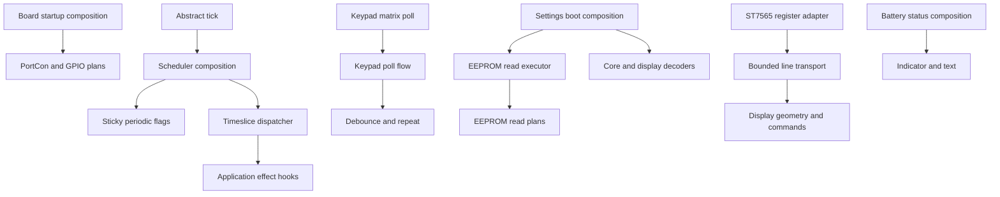

# Firmware components

Keep decisions and state independent of GPIO, interrupts, and display writes.
An adapter owns register access or other device I/O; a composition owns the
order in which components are called. A component should be testable with host
inputs or a mock backend without starting firmware.

## Existing connections

The arrows below show calls or data flow exercised offline, not a radio
execution trace. Where a composition accepts a trait, the connection ends at
that interface unless an adapter is shown explicitly.

The [development image](offline-image-evidence.md) boots only the reset
bootstrap. The [mixed fallback](abi-contract.md) and other standalone
link-inspection targets are evidence, not part of that image. Neither the
diagram nor a successful Cortex-M0 link establishes on-device behavior.

## Behavior and validation

| Area | Component docs |
| --- | --- |
| Startup and pins | [Target contract](target-contract.md), [Board sequence](board-sequence.md), [Board composition](board-startup-composition.md), [Clock gates](device-clock-gate-startup.md), [SysTick](systick-startup-adapter.md), [PortCon](portcon-startup-adapter.md), [GPIO](gpio-startup-adapter.md) |
| Scheduler | [Flag state](periodic-scheduler-flags.md), [Dispatch order](app-timeslice-dispatch.md), [Scheduler composition](app-scheduler-composition.md) |
| Keypad and application | [Matrix sampling](keyboard-matrix-scan.md), [Keypad polling](keyboard-poll-flow.md), [Numeric buffer](numeric-input-box.md), [Memory-channel entry](app-numeric-input-flow.md), [Scan continuation](app-scan-flow.md) |
| Settings and buses | [Settings boot](settings-boot-composition.md), [Core defaults](settings-boot-defaults-provenance.md), [Display defaults](display-boot-defaults-provenance.md), [EEPROM read transport](eeprom-read-transport.md), [I²C byte and edge sequence](i2c-bitbang-flow.md), [UART init plan](uart-init-plan-provenance.md) |
| Display and battery | [SPI0 init](spi0-startup-adapter.md), [LCD line transport](st7565-line-transport.md), [LCD register adapter](st7565-mmio-transport.md), [Backlight](backlight-plan-provenance.md), [Battery indicator](battery-indicator.md), [Battery text](battery-status-text.md), [Battery status composition](battery-status-composition.md) |
| Portable behavior | [Reference vectors and coverage](reference-vector-provenance.md), [Container format reuse](firmware-container-rust-reuse.md) |

## Adding or moving a component

Use the [scheduler module](../src/scheduler/mod.rs) as the first example. Its
flag state and dispatcher do not depend on each other. The composition imports
both and exposes effect hooks to the caller. Integration tests import the
library modules rather than defining second copies of the same Rust types.

Group related components under a subsystem module. Use a single definition of
shared types and ordinary imports where possible; keep register access and
target-specific code behind typed boundaries. Move existing files in scoped
changes rather than moving all subsystems at once.

For each component, document its inputs and outputs, owned state or side
effects, ordering and failure behavior, reference provenance, focused test
commands, and what the tests do not establish. Update the integration diagram
when wiring changes. Do not mark mock-backed, link-only, or planned wiring as
part of the running image.
