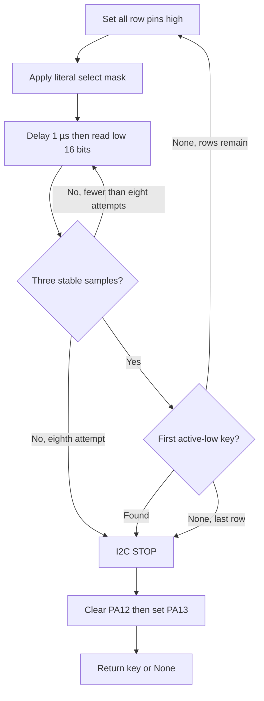

# Offline keyboard matrix scan

[`src/keyboard_matrix_scan.rs`](../src/keyboard_matrix_scan.rs) independently
models the public C
[`driver/keyboard.c:30–153`](https://github.com/egzumer/uv-k5-firmware-custom/blob/7607f0a4bd6203d1f06b70556fc1ce0d7399d6b3/driver/keyboard.c#L30-L153)
at pinned revision `7607f0a4bd6203d1f06b70556fc1ce0d7399d6b3`.
Pin numbers and GPIO update semantics follow
[`driver/gpio.h`](https://github.com/egzumer/uv-k5-firmware-custom/blob/7607f0a4bd6203d1f06b70556fc1ce0d7399d6b3/driver/gpio.h);
numeric key codes follow
[`driver/keyboard.h`](https://github.com/egzumer/uv-k5-firmware-custom/blob/7607f0a4bd6203d1f06b70556fc1ce0d7399d6b3/driver/keyboard.h).

## Interface and literal trace

`poll(&mut impl MatrixIo) -> Option<Key>` is allocation-free and standalone
`no_std`, intentionally not exported by the application library. `MatrixIo`
exposes a GPIOA DATA read-modify-write, a 32-bit GPIOA DATA read, a 1 µs delay
request, and I2C STOP. Each update means `(old & and_mask) | or_mask`; separate
updates must not be combined.

Each row begins with these two operations:

1. `update_gpioa(0xffffffff, 0x00003c00)` sets PA10–PA13 high.
2. `update_gpioa(select_mask, 0)` selects the row, including the zero row.

The active-low table is literal; rows and columns are checked left to right:

| Row | Select AND mask (32-bit) | PA3 | PA4 | PA5 | PA6 |
| --- | --- | --- | --- | --- | --- |
| Zero / side keys | `0x0000ffff` | Side1 | Side2 | — | — |
| PA10 low | `0x0000fbff` | Menu | 1 | 4 | 7 |
| PA11 low | `0x0000f7ff` | Up | 2 | 5 | 8 |
| PA12 low | `0x0000efff` | Down | 3 | 6 | 9 |
| PA13 low | `0x0000dfff` | Exit | Star | 0 | F |

The zero row also retains the C table's two invalid padding entries, both
testing PA4 again, not PA5 or PA6. They cannot win after the preceding Side2
entry. The first detected key ends scanning, so side keys outrank matrix keys,
earlier matrix rows outrank later ones, and lower-numbered columns win within
a row. There is no multi-key aggregation or ghost-key handling.

The select mask is a zero-extended **16-bit** value applied to the full 32-bit
port. Consequently, every selection clears bits 16–31, even the zero row's
otherwise redundant RMW. This is preserved, not replaced with a full-width
complement mask.

For each row, stability starts afresh with previous reading zero and count zero.
Each attempt requests a 1 µs delay **before** reading GPIOA. The reading is
truncated to 16 bits, and the entire resulting value is compared, including
non-key bits. An equal reading increments the count; a changed reading sets
the count to one, because that reading is already the first sample of its run.
Three consecutive equal samples succeed, including samples 6–8 of the
eight-attempt limit. Two equal readings at attempts 7–8 do not succeed.
An unstable row aborts the whole scan immediately, without selecting another
row or decoding a key from the noisy samples. Upper-half changes do not affect
stability; unrelated low-half changes do.

All normal outcomes (key, no key, noise abort) end with exactly:

1. `i2c_stop()` (the pinned STOP leaves PA10 and PA11 high).
2. `update_gpioa(0xffffefff, 0)` clears voice PA12.
3. `update_gpioa(0xffffffff, 0x00002000)` sets voice PA13.



## Boundaries and intentional differences

`None` replaces C's `KEY_INVALID` (19); actual keys retain their C numeric codes.
PTT (16) is absent: the pinned poll's PTT shortcut is commented out, and PTT is
not a matrix input. This module has its own sampled-key type and does not
depend on or modify the existing debounce/repeat decisions.

The I2C STOP is one explicit, opaque operation, not a port of its internal
bit-banging and delays. The model preserves the poll's call order around STOP;
it does not claim to model the internal I2C waveform. The interface is
infallible and normal-return cleanup is not an unwind/panic recovery guarantee.
There is no volatile access, hardware execution, timing measurement, application
wiring, board witness, LCD, or EEPROM work. This software-only evidence does
not close the parent hardware task.

## Focused validation

From the repository root:

```sh
cargo test --locked --test keyboard_matrix_scan
cargo clippy --locked --test keyboard_matrix_scan -- -D warnings
rustfmt --edition 2024 --check src/keyboard_matrix_scan.rs tests/keyboard_matrix_scan.rs
rustc --edition=2024 --crate-type=lib --target thumbv6m-none-eabi \
  -D warnings src/keyboard_matrix_scan.rs -o /tmp/keyboard_matrix_scan.rlib
```

[`tests/keyboard_matrix_scan.rs`](../tests/keyboard_matrix_scan.rs) checks every
key and its numeric code, competing columns and row priority, three-sample
acceptance including an initial zero and late stabilization at attempt eight,
eight-attempt rejection, independent row counters, noise on every low-16 bit
at every row, ignored upper-half noise, zero-row padding, and no-key traversal.
Every scenario asserts the complete mock trace: literal row masks, separate
RMWs, one delay before each read, immediate stopping, and STOP/clear/set cleanup.
The mock also checks the final port value from a nonzero upper-half initial
port, with STOP's pin-high postcondition modeled explicitly.
