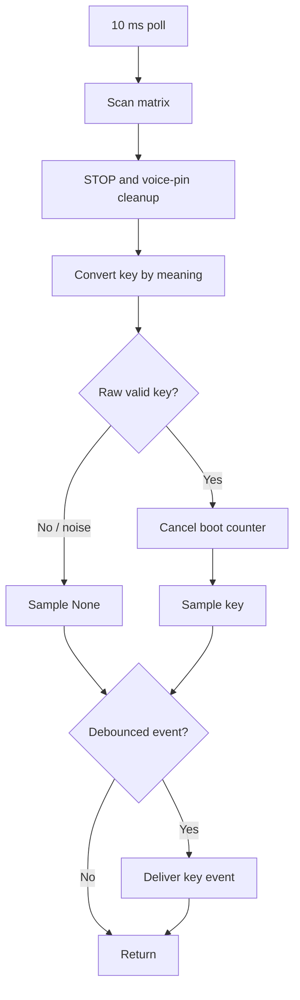

# Offline keyboard polling flow

[`src/keyboard_poll_flow.rs`](../src/keyboard_poll_flow.rs) composes
[`keyboard_matrix_scan::poll`](keyboard-matrix-scan.md) with
[`KeyboardDecisions::sample`](../src/keyboard_decisions.rs), following
[`app/app.c:1020–1085`](https://github.com/egzumer/uv-k5-firmware-custom/blob/7607f0a4bd6203d1f06b70556fc1ce0d7399d6b3/app/app.c#L1020-L1085)
and its [10 ms call site](https://github.com/egzumer/uv-k5-firmware-custom/blob/7607f0a4bd6203d1f06b70556fc1ce0d7399d6b3/app/app.c#L1234)
at revision `7607f0a4bd6203d1f06b70556fc1ce0d7399d6b3`.

The caller retains a `KeyboardPollFlow` and invokes `poll` once per 10 ms with
mockable `MatrixIo` and `KeypadEffects` implementations. The flow emits:

1. Scanner STOP, voice-pin clear, then voice-pin set, on every normal scan.
2. `cancel_boot_counter` for every raw valid matrix key, even before debounce
   and on every held-key poll. No-key and unstable/noisy scans do not cancel.
3. Any `key_event` produced by the retained decision state. A direct switch
   can release the previous key in the same poll, after cancellation.



The scanner's 18 keys map exhaustively to the corresponding decision keys
without numeric casts. No-key and noise both sample `None`; consequently,
sustained noise can debounce a release just like no-key. Press and release
require two unchanged ticks after a changed sample. The initial held event is
at 40 unchanged ticks, with subsequent Up/Down repeats every eight ticks.
`KeyboardDecisions` owns these timing rules and the flow does not reset its
state between polls.

This standalone `no_std` composition does not implement a boot screen,
scheduler, interrupt, GPIO MMIO, PTT, transmitter, or device wiring. The
caller must provide the cadence and apply the cancellation effect to its own
boot counter. Cleanup is guaranteed for normal scanner returns, not panic
recovery; these host mocks and target compilation are not hardware validation.
The parent hardware task remains open.

## Focused validation

From the repository root:

```sh
cargo test --locked --test keyboard_poll_flow --test keyboard_matrix_scan --test keyboard_decisions
cargo clippy --locked --test keyboard_poll_flow --test keyboard_matrix_scan --test keyboard_decisions -- -D warnings
rustfmt --edition 2024 --check src/keyboard_poll_flow.rs tests/keyboard_poll_flow.rs
rustc --edition=2024 --crate-type=lib --target thumbv6m-none-eabi \
  -D warnings src/keyboard_poll_flow.rs -o /tmp/keyboard_poll_flow.rlib
```

The composed mock tests cover all matrix key meanings, stable press and
release, held directional repeat, direct key switches, cancellation before
debounced events, and no-key/noise cleanup and release.
