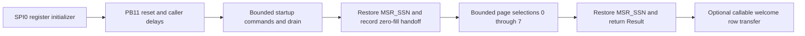

# ST7565 startup execution

`src/st7565_startup.rs` provides the pinned startup plan, and
`src/st7565_startup_executor.rs` provides its allocation-free executor.
`execute_startup` runs the plan through typed reset, delay and SPI
initialization hooks plus the existing bounded line transport. It is not
connected to firmware startup. Its `target_spi0` child provides a callable
MMIO boundary, without board-sequencer wiring.
Its source is
[`ST7565_Init`, `cmds`, `ST7565_HardwareReset` and `ST7565_WriteByte`](https://github.com/egzumer/uv-k5-firmware-custom/blob/7607f0a4bd6203d1f06b70556fc1ce0d7399d6b3/driver/st7565.c),
and [`SPI_ToggleMasterMode` and the FIFO drain](https://github.com/egzumer/uv-k5-firmware-custom/blob/7607f0a4bd6203d1f06b70556fc1ce0d7399d6b3/driver/spi.c)
at revision `7607f0a4bd6203d1f06b70556fc1ce0d7399d6b3`.

The SPI initialization effect is a typed caller hook. Reset levels are GPIO
RES levels; delays are requested milliseconds. The master-select effects
correspond to clearing and setting `MSR_SSN`, not disabling and enabling SPI.
Each command effect sets A0 low and uses the caller-supplied FIFO poll limit;
the drain effect uses the line transport's fixed `DRAIN_POLL_LIMIT`. If either
wait times out after `MSR_SSN` is cleared, execution restores the mode, returns
the corresponding `LineError`, and skips the remaining effects.

The last effect calls `fill_screen_handoff(0)` after restoring SPI mode. This
is the caller's handoff, not an executed clear. The pinned `DrawLine` uses its
`size_defVal` argument as both the loop bound and fill value, so this call
selects each page but writes **no** data bytes. The executor does not silently
write 128-byte zero lines; the caller owns any further action. The existing
`DisplayBlitPlan::draw_line` rejects empty payloads and is not used to model
the page-selection-only handoff.

## Callable target boundary

`st7565_startup_executor::target_spi0::startup_with_io` composes the real SPI0
initializer, `execute_startup`, and the MMIO line transport through mockable
32-bit register access and millisecond-delay traits. It takes an explicit
`NonZeroU32` FIFO poll budget; there is no production delay or FIFO-budget
default. The infallible fill hook records the handoff only. After startup
succeeds, the boundary executes the zero-fill handoff fallibly and returns its
error to the caller. An unexpected nonzero/missing handoff is rejected.



The final phase clears `MSR_SSN` once and visits pages 0 through 7 in order.
For each page it lowers A0, sends `0xb0 + page`, `0x10`, `0x04` (visible column
zero plus the pinned four-column offset), drains, raises A0, then drains
again. It sends **no pixel bytes**. There is no additional start-line command
in `FillScreen`; the startup sequence already sent `0x40` before `0xaf`.
Every FIFO wait uses the supplied per-byte limit; every drain uses the
existing `DRAIN_POLL_LIMIT = 100_001` status-read bound. Either timeout restores
`MSR_SSN`, stops later commands/pages, and returns `LineError`. A partial
command sequence may remain in the FIFO/panel; mode restoration is not rollback.
The startup boundary sends no screen data and publishes no boot-complete state.
The separate [welcome execution](startup-version-display.md#callable-welcome-execution)
can follow it with a version-row transfer; it does not wire startup into boot.

The ARM bare-metal-only unsafe `target_spi0::startup_mmio` takes
`&mut dyn DelayMs` and the explicit nonzero poll budget. This concrete entry
can be retained for target assembly inspection without a production delay
implementation. It uses aligned volatile `u32` accesses at the existing
physical mappings:

| Registers | Addresses |
| --- | --- |
| SPI0 CR, WDR, IE, IF, FIFOST | `0x400b8000`, `0x400b8004`, `0x400b8010`, `0x400b8014`, `0x400b8018` |
| SYSCON device clock gate | `0x40000008` |
| GPIOB DATA | `0x40060800` |

Before calling, the caller must provide the DP32G030 mappings, enabled GPIOB
and SPI0 clocks, operational FIFO/status registers, and an idle bus. SPI0 CR
is accessed before the initializer updates the clock gate, so that update
does not replace the prior-clock requirement. B7/B8/B10 must already be muxed
for display SPI0, PB9 configured as the A0 GPIO output, and PB11 configured as
the reset GPIO output and owned by the display, **not SWD**. Pin assignments
follow the pinned
[`driver/gpio.h`](https://github.com/egzumer/uv-k5-firmware-custom/blob/7607f0a4bd6203d1f06b70556fc1ce0d7399d6b3/driver/gpio.h).

Exclusive display/pin ownership and serialization against **every writer**
(including interrupts) to SPI0 CR/WDR/IE/IF/FIFOST, GPIOB DATA and the SYSCON
clock gate must hold throughout initialization, delays, and the final handoff.
GPIO reset/A0 and SPI mode updates use fresh read-modify-writes preserving
unrelated bits; SPI0 configuration retains the existing initializer's field
masks and intentional IE-zero replacement. Delay/register implementations
must be infallible and not panic; the caller's delay must provide the requested
milliseconds without accessing those shared registers. The boundary configures
no pin directions/muxes, supplies no arbitration or calibrated delay, and is
not wired into board startup.

The host traces check ordering, command values, repeated power writes and delay
requests, polling boundaries, and cleanup. They cannot establish elapsed time,
GPIO or SPI electrical behavior, successful FIFO completion, or panel
initialization; those require target and hardware evidence.

Focused checks from the repository root:

```sh
cargo test --locked --test st7565_target_startup --test st7565_startup \
  --test st7565_startup_executor --test st7565_display \
  --test st7565_line_transport --test st7565_mmio_transport \
  --test spi0_startup_adapter --test spi0_plan
cargo clippy --locked --test st7565_target_startup --test st7565_startup \
  --test st7565_startup_executor --test st7565_display \
  --test st7565_line_transport --test st7565_mmio_transport \
  --test spi0_startup_adapter --test spi0_plan -- -D warnings
cargo fmt --all -- --check
cargo rustc --locked --lib --target thumbv6m-none-eabi -- \
  -D warnings -C opt-level=2 -C link-dead-code=yes --emit=asm
cargo clippy --locked --target thumbv6m-none-eabi --release -- -D warnings
```

`tests/st7565_target_startup.rs` checks the literal physical-register trace,
SPI0-before-reset ordering, fresh snapshots and unrelated-bit preservation,
all eight zero-fill page selections, all 41 FIFO-write timeout positions,
all 17 drain timeout positions, and last-permitted-poll success. The Cortex-M0
library check retains the target entry and emits assembly under
`target/thumbv6m-none-eabi/debug/deps/` for volatile word-access inspection.
These are host/compile checks, not physical timing or bench evidence; no
flashing, target execution, bootloader work, or release artifact is involved.
