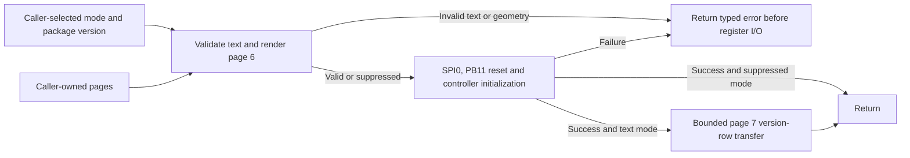

# Offline startup version display

[`src/startup_version_display.rs`](../src/startup_version_display.rs) builds a
fixed-size, allocation-free plan for the M0HDY startup version text. With no
version it produces `M0HDY`; with a supplied version it produces
`M0HDY <version>`. An explicitly empty version is rejected. Versions must
contain printable ASCII bytes, and text wider than the display is rejected.
The `None` and `FullScreen` display modes suppress the version text without
validating an unused version.

The placement follows the text-bearing branch of upstream
[`ui/welcome.c`](https://github.com/egzumer/uv-k5-firmware-custom/blob/7607f0a4bd6203d1f06b70556fc1ce0d7399d6b3/ui/welcome.c#L42-L76)
at pinned revision
[`7607f0a4bd6203d1f06b70556fc1ce0d7399d6b3`](https://github.com/egzumer/uv-k5-firmware-custom/tree/7607f0a4bd6203d1f06b70556fc1ce0d7399d6b3).
That branch draws the small-normal version at line 6 with bounds 0–128.
[`ui/helper.c`](https://github.com/egzumer/uv-k5-firmware-custom/blob/7607f0a4bd6203d1f06b70556fc1ce0d7399d6b3/ui/helper.c#L91-L116)
centers that text using the glyph width plus one spacing column. The pinned
[`font.c`](https://github.com/egzumer/uv-k5-firmware-custom/blob/7607f0a4bd6203d1f06b70556fc1ce0d7399d6b3/font.c)
defines `gFontSmall` as six columns for each visible ASCII glyph. The renderer
uses those columns directly; it skips spaces and bytes outside `!` through `~`.
The glyph data is copyright 2023 Dual Tachyon and licensed under Apache-2.0;
the source notice and license terms are retained beside the table in
`src/startup_version_display.rs`.

`StartupVersionDisplayPlan::render_page` composes the existing plan with a
caller-owned array of 128-column pages and writes only the selected page 6.
`render_small_normal_text_at` is the lower-level fixed-position renderer: its
start column is literal and it does not center again. It rejects a row whose
width is not 128 or text whose full spacing extent is out of bounds before
writing any glyphs. `None` and `FullScreen` plans are no-ops; a visible plan
requires the page array to contain page 6.

[`src/startup_version_row_plan.rs`](../src/startup_version_row_plan.rs)
composes that renderer with `DisplayBlitPlan::framebuffer_line`. A visible
version returns a blit plan for framebuffer line 6, selecting controller page
7 (page 0 is the status row); suppressed modes return no row plan.

The renderer, framebuffer plan, and row composition are available through the
`startup_version_display`, `st7565_display`, and `startup_version_row_plan`
library modules. Their public signatures share the same
`StartupVersionDisplayPlan` and `DisplayBlitPlan` types. Rendering failures
and any invalid framebuffer plan for a visible row are returned as
`StartupVersionRowError`; the latter is distinct from a suppressed row.

The renderer trait still makes planned text and placement mockable. Golden
tests compare the M0HDY-only and M0HDY-dev outputs against independent bytes on
patterned pages, checking that glyph spacing, other pages, and untouched
columns remain unchanged.

## Callable welcome execution

[`welcome_startup`](../src/welcome_startup.rs) composes those plans with the
[concrete SPI0/reset startup](st7565-startup.md) and bounded ST7565 MMIO
transport. `welcome_with_io` accepts a caller-selected `StartupDisplayMode`,
caller-owned framebuffer pages, a delay provider and a nonzero per-byte FIFO
poll budget. It uses `CARGO_PKG_VERSION` from the package manifest;
`welcome_with_version_and_io` permits explicit version injection. Both are
allocation-free and host-testable. The caller supplies infallible,
non-panicking register and delay implementations.



In text modes the exact plan sends `0x40`, `0xb7`, `0x10`, `0x04`, then
128 rendered bytes, using the existing MMIO transport and bounded FIFO/drain
operations. Other pages and untouched columns are preserved. `None` and
`FullScreen` skip version validation and row transfer, but still perform
controller initialization, including its page-selection-only zero-fill
handoff. This is not the upstream full welcome screen or its full-screen
fill branch: no status row, welcome strings, voltage, or full framebuffer is
transferred by this boundary.

Version and row geometry errors occur before register accesses or delays.
Rendering occurs before initialization and may modify page 6 even if later
I/O fails. Initialization errors prevent the row transfer. A FIFO or drain
timeout during a transfer stops later writes and restores `MSR_SSN`; already
sent or queued bytes and framebuffer modifications are not rolled back.
Each FIFO wait is limited by the caller's budget and each drain by
`DRAIN_POLL_LIMIT` (100,001 reads).

On ARM bare-metal targets, unsafe `welcome_mmio` executes the same composition
using volatile DP32G030 accesses. The caller must provide the mapped SPI0
CR/WDR/IE/IF/FIFOST, GPIOB DATA and SYSCON clock-gate registers, enabled
GPIOB and SPI0 clocks, operational status flags, and an idle bus. Configure
B7/B8/B10 for display SPI0, PB9 as the A0 GPIO output, and PB11 as the
display reset GPIO output, **not live SWD**. No pin direction or mux is set
by this entry. The delay must correctly supply the requested milliseconds,
must not panic, and must not access the shared registers. Exclusive display
and pin ownership and serialization against every writer to these whole
registers, including interrupts and writers of unrelated bits, must hold for
the entire call, across delays and row transfer. See the
[startup backend](st7565-startup.md#callable-target-boundary) for the exact
register mappings and initialization requirements.

This is a callable offline-validated entry, not evidence that the default
`Reset_Handler` or application boot invokes it. Board/firmware entry wiring
and acquisition of the actual startup-selected mode remain separate work.

Run focused checks from the repository root:

```sh
cargo test --locked --test startup_version_display
cargo clippy --locked --test startup_version_display -- -D warnings
cargo test --locked --test startup_version_row_plan
cargo clippy --locked --test startup_version_row_plan -- -D warnings
cargo test --locked --test welcome_startup
cargo clippy --locked --test welcome_startup -- -D warnings
cargo fmt --all -- --check
rustc --edition=2024 --crate-type=lib --target thumbv6m-none-eabi \
  -D warnings src/startup_version_display.rs -o /tmp/startup_version_display.rlib
RUSTFLAGS="-D warnings" cargo check --locked --lib --target thumbv6m-none-eabi
```
