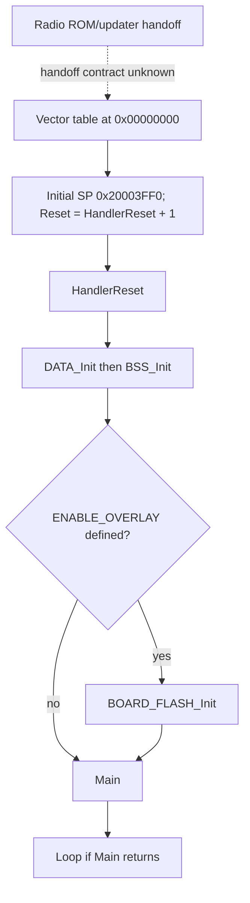

# MCU and firmware image contract

This is the migration baseline for the UV-K5(8) Rust firmware target. It records
what can be checked in the project and in the pinned C reference; it does not
certify a particular radio, bootloader, or Rust binary.

The C evidence below is pinned to
[`egzumer/uv-k5-firmware-custom` at `7607f0a4bd6203d1f06b70556fc1ce0d7399d6b3`](https://github.com/egzumer/uv-k5-firmware-custom/tree/7607f0a4bd6203d1f06b70556fc1ce0d7399d6b3).
The project README identifies this repository's target as the UV-K5(8)
([README](../README.md)). The reference README describes its firmware as
targeting UV-K5/K6/5R radios; that broader wording does not establish that every
model or hardware revision is compatible.

## Evidence status

- **Verified in source** means the pinned C source explicitly specifies it.
- **Not established** means the source does not prove the hardware or bootloader
  behavior; treat it as a question to resolve before implementation or flashing.

The pinned reference contains source and build inputs, not a Rust image or
per-device validation report. No Rust image was built or flashed as part of this
contract discovery.

## Target and core

| Item | Contract |
| --- | --- |
| Project board target | Quansheng UV-K5(8), as named by this repository's README. |
| MCU family | The C build contains DP32G030-specific BSP definitions and the OpenOCD configuration names the target `DP32G0xx`. |
| Core | ARM Cortex-M0: the C build passes `-mcpu=cortex-m0`, startup assembly declares `.cpu cortex-m0`, and OpenOCD creates a `cortex_m` target. |
| Exact board revision / MCU stepping | **Not established.** Confirm the radio label and hardware revision for each device; do not infer compatibility from the C README's UV-K5/K6/5R description. |

Sources: [project README](../README.md), [C reference Makefile](https://github.com/egzumer/uv-k5-firmware-custom/blob/7607f0a4bd6203d1f06b70556fc1ce0d7399d6b3/Makefile#L186-L202), [C reference startup](https://github.com/egzumer/uv-k5-firmware-custom/blob/7607f0a4bd6203d1f06b70556fc1ce0d7399d6b3/start.S#L13-L18), [OpenOCD config](https://github.com/egzumer/uv-k5-firmware-custom/blob/7607f0a4bd6203d1f06b70556fc1ce0d7399d6b3/dp32g030.cfg#L1-L15).

## Clocks and peripherals

### Clocks

The C reference does **not** establish a complete power-on clock contract:

- `SYSTEM_ConfigureClocks()` has a comment saying “Set source clock from
  external crystal,” then writes the `RCHF` 48 MHz selection and divides the
  selected clock by two. The source does not resolve that comment/register
  discrepancy or verify the resulting clock against a device.
- Startup calls `BOARD_FLASH_Init()` only when `ENABLE_OVERLAY` is defined;
  that routine calls `SYSTEM_ConfigureClocks()`. The Makefile defaults
  `ENABLE_OVERLAY` to `0` (and disables it when LTO is enabled), so this is not
  the normal default startup clock initialization.
- `SYSTICK_Init()` configures SysTick with `480000` ticks and records a
  multiplier of `48`; it does not itself configure or measure the core clock.

Thus, 48 MHz/divide-by-two is a **conditional source setting**, not a verified
frequency at Rust entry. Confirm oscillator source, startup clock state,
peripheral clocks, and timing assumptions from authoritative device material or
measurement before relying on them.

Sources: [clock routine](https://github.com/egzumer/uv-k5-firmware-custom/blob/7607f0a4bd6203d1f06b70556fc1ce0d7399d6b3/driver/system.c#L27-L35), [conditional overlay setup](https://github.com/egzumer/uv-k5-firmware-custom/blob/7607f0a4bd6203d1f06b70556fc1ce0d7399d6b3/board.c#L45-L56), [build defaults](https://github.com/egzumer/uv-k5-firmware-custom/blob/7607f0a4bd6203d1f06b70556fc1ce0d7399d6b3/Makefile#L55-L67), [SysTick setup](https://github.com/egzumer/uv-k5-firmware-custom/blob/7607f0a4bd6203d1f06b70556fc1ce0d7399d6b3/driver/systick.c#L24-L28).

### MCU peripherals evidenced by the C reference

The reference enables clock gates for GPIOA/B/C, UART1, SPI0, SARADC, CRC,
AES, and PWM_PLUS0 in `Main`. Its board setup also configures the GPIO and pin
multiplexer and samples SARADC channels 4 (battery voltage) and 9 (battery
current). This is a source-derived usage map, not a complete silicon register
map or a guarantee that Rust must initialize every listed block.

The board source assigns UART1 TX/RX to A7/A8, SARADC channels to A9/A14,
SPI0 signals to B7/B8/B10, and radio/display/keypad-related functions across
ports A, B, and C. Pin multiplexing is conditional in places, including B11/B14
for display versus SWD. Reconcile this table against the exact board revision
before enabling pin outputs or SWD.

Sources: [clock gates in Main](https://github.com/egzumer/uv-k5-firmware-custom/blob/7607f0a4bd6203d1f06b70556fc1ce0d7399d6b3/main.c#L60-L74), [board pin setup](https://github.com/egzumer/uv-k5-firmware-custom/blob/7607f0a4bd6203d1f06b70556fc1ce0d7399d6b3/board.c#L80-L225), [ADC configuration](https://github.com/egzumer/uv-k5-firmware-custom/blob/7607f0a4bd6203d1f06b70556fc1ce0d7399d6b3/board.c#L454-L482).

### Exception and peripheral interrupt vectors

The linker places the kept `.text.isr` section at the start of flash. The
startup source lays out the initial stack pointer, Reset, Cortex-M0 core
exceptions, then the DP32G030-named peripheral vectors in this order. The IRQ
numbers below follow the vector order after the 16 core vector words.

| IRQ | Vector names in `start.S` |
| ---: | --- |
| 0–4 | WWDT, IWDT, RTC, DMA, SARADC |
| 5–12 | TIMER_BASE0, TIMER_BASE1, TIMER_PLUS0, TIMER_PLUS1, PWM_BASE0, PWM_BASE1, PWM_PLUS0, PWM_PLUS1 |
| 13–20 | UART0, UART1, UART2, SPI0, SPI1, IIC0, IIC1, CMP |
| 21–28 | TIMER_BASE2, GPIOA5, GPIOA6, GPIOA7, GPIOB0, GPIOB1, GPIOC0, GPIOC1 |
| 29–31 | GPIOA, GPIOB, GPIOC |

Reserved core exception entries are zero. The reference's default fault and
peripheral handlers branch to themselves; the default SysTick handler returns.
This enumerates the C vector ABI only; confirm vector numbering and IRQ behavior
against the selected MCU documentation before translating it.

Source: [linker section placement](https://github.com/egzumer/uv-k5-firmware-custom/blob/7607f0a4bd6203d1f06b70556fc1ce0d7399d6b3/firmware.ld#L14-L32), [vector table and default handlers](https://github.com/egzumer/uv-k5-firmware-custom/blob/7607f0a4bd6203d1f06b70556fc1ce0d7399d6b3/start.S#L31-L240).

## Boot and reset baseline

The source establishes the C image's reset path, not the radio's complete
ROM/bootloader/update sequence:

1. The linker entry is `HandlerReset`; flash starts at address zero and the
   `.text.isr` vector section is retained first in `.text`.
2. The vector table's first word is `0x20003FF0`, followed by
   `HandlerReset + 1` for the Thumb reset address.
3. `HandlerReset` explicitly sets SP to `0x20003FF0`, calls `DATA_Init`, then
   `BSS_Init`, conditionally calls `BOARD_FLASH_Init` for overlay builds, calls
   `Main`, and loops if `Main` returns.
4. `DATA_Init` copies the initialized data image from its flash load location
   to RAM; `BSS_Init` zeroes the RAM BSS range.

The linker separately defines `_estack = 0x20004000`, 16 bytes above the
hard-coded vector/reset SP. Both values are confirmed in source; their intended
relationship is **not explained** and must not be silently normalized during
migration.

The Rust bootstrap preserves the reference's `0x20003FF0` vector SP rather
than replacing it with the linker top. Its linker map defines RAM as
`0x20000000`–`0x20003FFF` and reserves `0x20003800`–`0x20003FFF` for the Rust
stack budget; the linker represents those as separate 14 KiB static-RAM and
2 KiB stack regions, with `__stack_top` at `0x20004000`. The 16-byte SP
difference remains unexplained. The reset routine copies `.data`, clears
`.bss`, then calls the minimal Rust entry. The 48-word table includes the 16
core vectors and 32 peripheral slots in the order above. These are
source/layout facts only: no bootloader handoff, vector relocation, clocks,
peripherals, or device behavior is assumed or established.

**Not established:** whether the on-device boot ROM or updater always transfers
control to address zero, checks an image header or CRC, relocates vectors,
changes clocks, or uses another handoff address. The C source does not document
those rules or the contents/ownership of the final flash region. Confirm those
details independently for the target radio and its currently installed
bootloader.



Sources: [entry, memory, and section layout](https://github.com/egzumer/uv-k5-firmware-custom/blob/7607f0a4bd6203d1f06b70556fc1ce0d7399d6b3/firmware.ld#L1-L32), [reset vector and stack word](https://github.com/egzumer/uv-k5-firmware-custom/blob/7607f0a4bd6203d1f06b70556fc1ce0d7399d6b3/start.S#L31-L40), [HandlerReset](https://github.com/egzumer/uv-k5-firmware-custom/blob/7607f0a4bd6203d1f06b70556fc1ce0d7399d6b3/start.S#L243-L253), [data and BSS initialization](https://github.com/egzumer/uv-k5-firmware-custom/blob/7607f0a4bd6203d1f06b70556fc1ce0d7399d6b3/init.c#L25-L47).

## Memory and address contract

The C linker script explicitly defines the application regions:

| Region | Inclusive address range | Size | Contract |
| --- | --- | ---: | --- |
| Application flash | `0x00000000`–`0x0000EFFF` | 60 KiB | Linker FLASH origin `0x00000000`, length `60K`. Keep the application image within this range. |
| Reserved flash tail | `0x0000F000`–`0x0000FFFF` | 4 KiB | Excluded from the 60 KiB application region and reserved by this migration contract for existing updater/boot use. The pinned linker script does **not** identify its contents or prove the bootloader's exact boundary; verify on the specific device and do not write or erase it. |
| RAM | `0x20000000`–`0x20003FFF` | 16 KiB | Linker RAM origin `0x20000000`, length `16K`; the exclusive end is `0x20004000`. |

The 4 KiB reserved-tail range assumes a 64 KiB flash partition. The C linker
establishes the 60 KiB application boundary, but does not establish the
physical flash capacity or prove that the updater occupies the entire tail.
Treat the range as a conservative integration boundary until those facts are
confirmed for the device.

**Load address versus execution address:**

- The raw application image is linked for flash at address zero; the C
  Makefile's OpenOCD `flash` target passes `firmware.bin` to the custom writer
  at address `0`.
- Code and constants execute from their flash-linked addresses. `.data` has a
  RAM execution address (`>RAM`) and a flash load image (`AT> FLASH`); startup
  copies that load image into RAM. `.bss` is RAM-only and is cleared by startup.
- The packed updater container described below is transformed data, not the
  raw linked payload. It has no address field in the packer and must not be
  passed to the raw OpenOCD write path as though it were a flash image.

### Automated image budget gate

The host-side gate at `scripts/check_memory_budget.py` validates ELF32
`PT_LOAD` ranges and the raw payload generated from that ELF. It uses
file-backed load ranges (`p_paddr`/`p_filesz`) for flash load bytes and
execution/memory ranges (`p_vaddr`/`p_memsz`) for runtime placement. This
includes initialized RAM data's flash load image and the complete RAM extent
of `.data`/`.bss`. Non-loadable debug data and ELF file length do not
contribute to either budget. The raw payload must start at the application
origin, end at the last file-backed load byte, and match the ELF load bytes;
gaps between load ranges use objcopy's zero-filled padding. File-backed flash
XIP segments must have matching VMA and LMA. Raw payload bytes are independently
limited to 61,440; packed-container length is reported separately and is not
limited by that raw-image cap. Retain the section headers in the ELF used by
the gate: every nonempty allocated section must fit within its permitted
region and a load segment, except a validated `.stack` reservation. This
prevents RAM from being omitted from accounting by an unassigned `.bss`.

The current Rust integration policy reserves 2,048 bytes for stack at the top
of RAM (`0x20003800`–`0x20003FFF`). This is a conservative budget reservation,
not a measured stack high-water mark or a value established by the older C
startup. The gate requires callers to pass exactly `--stack-reservation 0x800`;
it has no default and rejects any other reservation. Static RAM ranges may not
overlap the reserved stack. A linked reservation counts once if it is named
`.stack`, occupies exactly the reserved range, is writable allocated `NOBITS`,
and contains neither initialized load bytes nor another allocated section.
With that explicit marker the gate excludes the reservation from static RAM
even when it is included in a RAM `PT_LOAD`. Change the policy only with
documented stack analysis and matching checker and fixture updates.

With rustup and Python 3 installed, build the release ELF and linker map from
the repository root before running the startup check and host fixtures:

```sh
cargo rustc --locked --target thumbv6m-none-eabi --release \
  --bin uv-k5-rust-firmware -- \
  -C link-arg=-Map=target/thumbv6m-none-eabi/release/uv-k5-rust-firmware.map
python3 scripts/check_startup_layout.py \
  --elf target/thumbv6m-none-eabi/release/uv-k5-rust-firmware \
  --map target/thumbv6m-none-eabi/release/uv-k5-rust-firmware.map
python3 -m unittest discover -s tests -v
```

The startup-layout check validates the ELF entry and Reset vector, Thumb bit,
initial SP, vector-table size and address, allocated section and load-segment
ranges, stack reservation, and corresponding linker-map symbols. Its positive
and negative fixtures are in `tests/test_startup_layout.py`.

For the same real-image regression CI runs, install GNU ARM binutils
(`binutils-arm-none-eabi` on Ubuntu) and run the test command with
`ARM_BINUTILS_PREFIX=arm-none-eabi-`. The test assembles and links a disposable
Cortex-M0 ELF, then generates and checks its raw image using ARM objcopy.

For the CI development-image pipeline, create the raw payload from its ELF,
pack that same raw file, and run all checks before uploading raw or packed
outputs:

```sh
arm-none-eabi-objcopy -O binary firmware.elf firmware.bin
python3 scripts/firmware_container.py pack firmware.bin firmware.packed \
  --author UV-K5 --version dev
python3 scripts/check_firmware_image.py \
  --elf firmware.elf \
  --map firmware.map \
  --raw firmware.bin \
  --packed firmware.packed \
  --author UV-K5 \
  --version dev
```

The image gate checks startup layout, the exact ELF/raw load bytes and memory
budgets, then the packed container's CRC/version and equality with the raw
payload. The budget report includes loadable segment ranges and used/remaining
flash and RAM. CI retains the ELF/map diagnostics after a successful link even
when validation fails, and only uploads raw/packed development outputs when all
checks pass. A separate disposable CI job appends one byte to the raw image and
requires the gate to reject it before any raw/packed upload. These outputs are
unvalidated development artifacts; the current target is not hardware-validated
and is not a flashable or release image.

Sources: [linker memory regions and data load/run placement](https://github.com/egzumer/uv-k5-firmware-custom/blob/7607f0a4bd6203d1f06b70556fc1ce0d7399d6b3/firmware.ld#L1-L12), [`.data`/`.bss` placement](https://github.com/egzumer/uv-k5-firmware-custom/blob/7607f0a4bd6203d1f06b70556fc1ce0d7399d6b3/firmware.ld#L34-L68), [raw image writer invocation](https://github.com/egzumer/uv-k5-firmware-custom/blob/7607f0a4bd6203d1f06b70556fc1ce0d7399d6b3/Makefile#L432-L436).

## Image formats and build tools

### Raw payload

The reference links an ELF named `firmware`, then runs
`arm-none-eabi-objcopy -O binary firmware firmware.bin`. This `firmware.bin` is
the raw linked payload expected by the C OpenOCD target at load address zero;
it contains no ELF symbols or address metadata. Its maximum application span is
the linker-defined 60 KiB, and the final linked artifact must be checked for
size and vector contents before any use.

### Packed updater container

`fw-pack.py` reads the raw binary and creates `firmware.packed.bin` by:

1. Inserting a 16-byte, NUL-padded `*<author> <version>` string at offset
   `0x2000` (the string is truncated to 16 bytes).
2. XORing the resulting bytes with the packer's fixed 128-byte repeating
   obfuscation table.
3. Computing CRC-XMODEM over those transformed bytes and appending the two CRC
   bytes in reversed digest order.

The resulting file is 18 bytes longer than the raw payload. The Makefile only
invokes the packer when Python and `crcmod` are available; it does not pin the
Python or `crcmod` version. The C source shows the format-generation algorithm,
but does not prove which updater consumes it or that a Rust payload will be
accepted. Keep raw and packed artifacts clearly named and separately hashed.

Sources: [raw and packed build targets](https://github.com/egzumer/uv-k5-firmware-custom/blob/7607f0a4bd6203d1f06b70556fc1ce0d7399d6b3/Makefile#L404-L430), [container transformation](https://github.com/egzumer/uv-k5-firmware-custom/blob/7607f0a4bd6203d1f06b70556fc1ce0d7399d6b3/fw-pack.py#L1-L35).

#### Host-side codec

The standard-library-only host utility implements the pinned container format:

```sh
python3 scripts/firmware_container.py pack firmware.bin firmware.packed.bin \
  --author "Author" --version "1.0"
python3 scripts/firmware_container.py validate firmware.packed.bin \
  --author "Author" --version "1.0"
python3 scripts/firmware_container.py unpack firmware.packed.bin recovered.bin
python3 -m unittest discover -s tests -p 'test_firmware_container.py' -v
```

The pinned `fw-pack.py` forms the transformed input as
`raw[:0x2000] + version_field + raw[0x2000:]`. For a raw payload shorter than
`0x2000`, Python's slice leaves the complete payload on the left and inserts
the 16-byte version field at the end. The utility preserves this behavior
without padding the payload. Its tests use the approved checksum fixture and
deterministic synthetic payloads; they do not need the C checkout or `crcmod`.

This codec checks the container CRC, version field, and reversible payload
transformation only. It does not validate ELF layout, prove updater acceptance,
or make any image—including this repository's non-flashable bootstrap—suitable
for flashing. The packed container is not a substitute for the raw payload.

### Tool versions in the reference

- The reference README recommends **arm-none-eabi GCC 10.3.1**; it warns that
  other versions may produce an image too large. This is a recommendation, not
  a version lock enforced by the Makefile.
- The Makefile uses `arm-none-eabi-gcc` for assembly and linking, with
  `-mcpu=cortex-m0`, `-Os`, C2x, and LTO enabled by default; it uses
  `arm-none-eabi-objcopy` and `arm-none-eabi-size`. Clang is an experimental
  alternative and disables LTO.
- Python 3 and `crcmod` are needed for the packed output. The reference README
  mentions Python 3.8 in its Windows install example; neither Python nor
  `crcmod` is pinned for all build methods.
- The Dockerfile uses `archlinux:latest` and installs rolling Arch packages;
  it does not make the toolchain reproducible.
- The Makefile invokes `/opt/openocd/bin/openocd`, but no OpenOCD version is
  specified. The compatible OpenOCD version is therefore **not established**.

Sources: [compiler recommendation](https://github.com/egzumer/uv-k5-firmware-custom/blob/7607f0a4bd6203d1f06b70556fc1ce0d7399d6b3/README.md#L130-L137), [Makefile compiler and flags](https://github.com/egzumer/uv-k5-firmware-custom/blob/7607f0a4bd6203d1f06b70556fc1ce0d7399d6b3/Makefile#L186-L242), [link and binary flags](https://github.com/egzumer/uv-k5-firmware-custom/blob/7607f0a4bd6203d1f06b70556fc1ce0d7399d6b3/Makefile#L381-L385), [Python example](https://github.com/egzumer/uv-k5-firmware-custom/blob/7607f0a4bd6203d1f06b70556fc1ce0d7399d6b3/README.md#L168-L179), [Dockerfile](https://github.com/egzumer/uv-k5-firmware-custom/blob/7607f0a4bd6203d1f06b70556fc1ce0d7399d6b3/Dockerfile#L1-L12).

## DP32G030 OpenOCD setup

The reference Makefile uses the J-Link interface config together with
`dp32g030.cfg`. That custom configuration selects SWD at adapter speed `32000`,
configures a `DP32G0xx` DAP and Cortex-M target, and implements flash access via
controller registers. The Makefile's raw `flash` command writes
`firmware.bin` at address zero. The configuration contains sector erase,
unlock/write/lock, and a flash-mask change; it is destructive programming
logic, not a safe inspection-only command.

The adapter, reset wiring, OpenOCD build/version, flash geometry, and erase
effects have not been independently validated for a physical device. Do not
invoke `make flash` or the custom write procedure during contract discovery.

Sources: [OpenOCD Makefile targets](https://github.com/egzumer/uv-k5-firmware-custom/blob/7607f0a4bd6203d1f06b70556fc1ce0d7399d6b3/Makefile#L432-L436), [DP32G030 SWD, target, and flash procedures](https://github.com/egzumer/uv-k5-firmware-custom/blob/7607f0a4bd6203d1f06b70556fc1ce0d7399d6b3/dp32g030.cfg#L1-L112).

## Pre-flash inspection checklist

Before any Rust image is considered for programming:

- [ ] Record the exact radio model, board revision, MCU marking, and current
  bootloader/updater version; confirm the target is within the intended
  UV-K5(8) scope.
- [ ] Obtain and retain a verified, restorable backup of the current flash and
  device-specific settings/calibration. Confirm the backup can be restored by
  the available recovery path.
- [ ] Build the ELF and raw binary from a recorded source commit and toolchain;
  save build logs and SHA-256 hashes for the ELF, raw binary, and (if produced)
  packed container.
- [ ] Inspect ELF entry point, load/run segments, vector base and contents,
  initial stack pointer, Reset vector, image length, and end address. Require
  the raw payload to fit wholly in `0x00000000`–`0x0000EFFF`; reject any
  unexpected writes or erases reaching `0x0000F000`–`0x0000FFFF`.
- [ ] Verify whether the intended consumer needs raw or packed format. For a
  packed file, independently verify inserted version bytes, transformed
  length, CRC, and the updater's accepted format. Never substitute the packed
  container for the raw OpenOCD input.
- [ ] Review the exact programmer command, interface file, custom target config,
  selected address, erase ranges, and reset behavior. Do not rely on defaults
  or a previous device's settings.
- [ ] Confirm an operator-controlled recovery path before programming: known
  good image for this exact hardware, working and tested stock recovery/update
  mechanism or compatible SWD probe and documented recovery procedure, required
  drivers/cables/power, and a second device or other means to confirm the
  recovery image. If any prerequisite is missing, do not flash.
- [ ] After any separately authorized device test, record the device identity,
  exact image hashes, tool versions, command/procedure, result, and recovery
  outcome. A successful build or inspection is not a successful device test.

## Validation evidence and open questions

Target builds and startup-layout checks validate the ELF entry, reset vector,
initial SP, allocated sections, memory ranges, and linker map. Host tests check
positive and negative startup-layout fixtures and the memory-budget gate. CI
records hashes for the target ELF and linker map and retains those files for
review; it does not produce raw or packed images. No device was flashed or
per-device validation attempted; this work is limited to offline structural
checks and no device-specific result is available. These checks do not
establish bootloader acceptance, image safety, or hardware compatibility.

Resolve these items before freezing the Rust startup and image interface:

1. Identify the exact UV-K5(8) board revision and MCU stepping that define the
   supported hardware set.
2. Establish reset-time clock source/frequency and any inherited bootloader
   state; reconcile the C clock-source comment with the `RCHF` register setup.
3. Confirm the peripheral register/IRQ definitions and pin multiplexing against
   authoritative DP32G030 material and the target board.
4. Explain the `0x20003FF0` startup SP versus linker `_estack`/`__stack_top` at
   `0x20004000`; the Rust layout intentionally preserves the documented
   discrepancy pending authoritative evidence.
5. Verify the updater's actual flash layout, reserved-tail ownership, handoff
   address, raw/packed acceptance rules, and non-destructive recovery procedure
   on the exact hardware.
